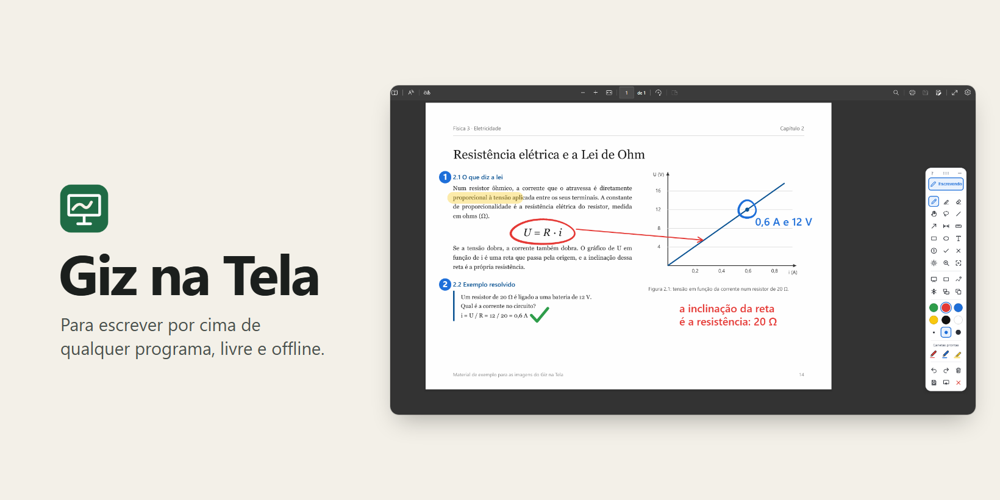
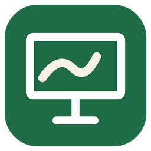
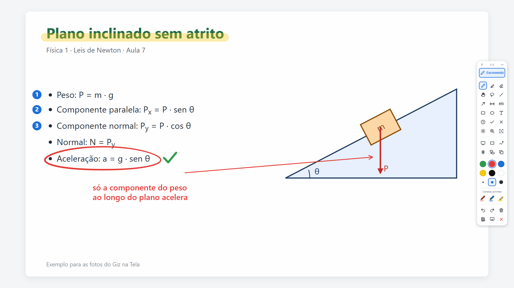
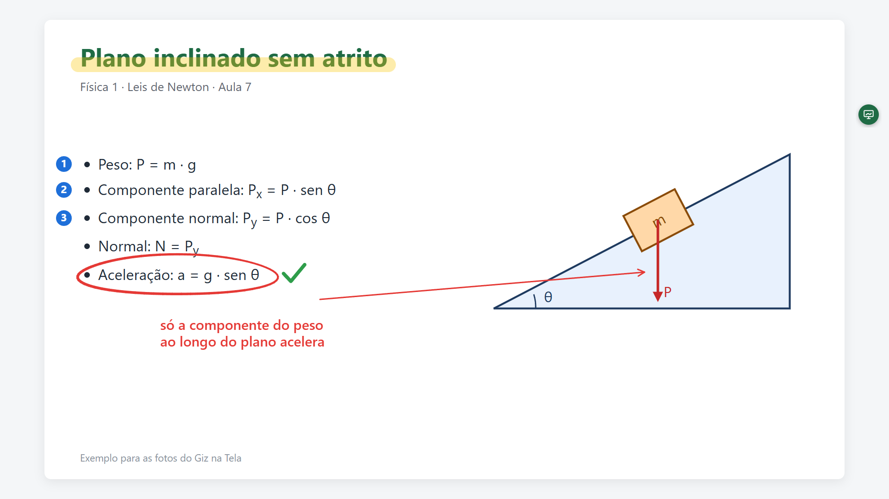
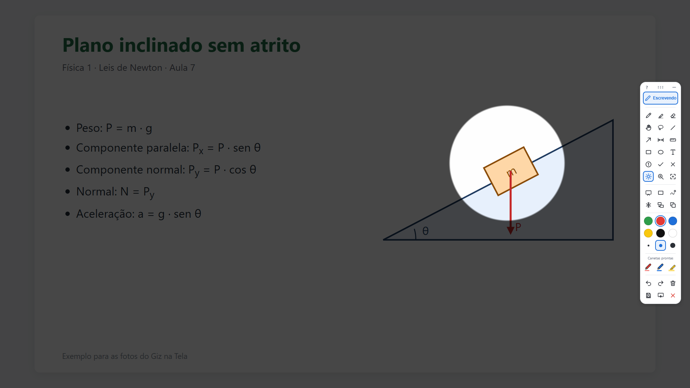
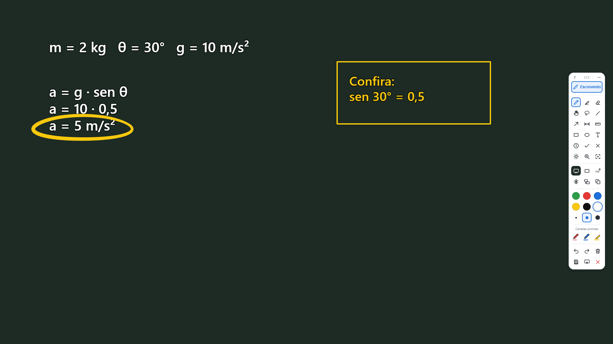
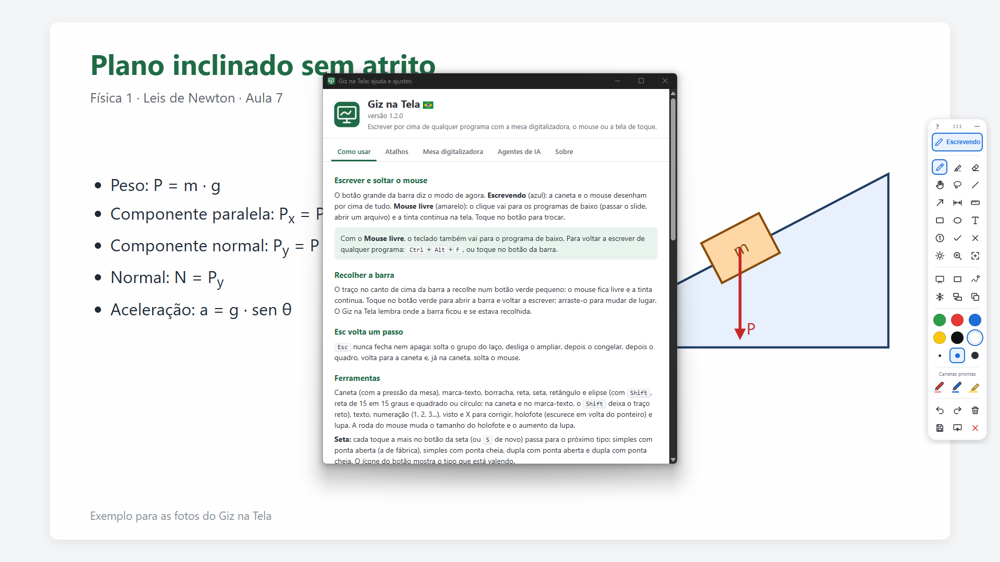

<p align="center"></p>

#  Giz na Tela 

[](https://github.com/HeraldoAntunes/giz-na-tela/actions/workflows/testes.yml)
[](https://scorecard.dev/viewer/?uri=github.com/HeraldoAntunes/giz-na-tela)
[](https://github.com/HeraldoAntunes/giz-na-tela/releases/latest)
[](https://github.com/HeraldoAntunes/giz-na-tela/releases)
[](https://doi.org/10.5281/zenodo.23690523)
[](LICENSE)
[](#requisitos)

**Escrever por cima de qualquer programa: slides, PDF, navegador, vídeo, simulação.** Uma camada transparente cobre a
tela e uma barra pequena traz caneta, marca-texto, formas, texto, numeração, visto e X, holofote e lupa. Feito por um
professor para as próprias aulas com mesa digitalizadora; funciona também com mouse e tela de toque.

<p align="center">
  <a href="https://github.com/HeraldoAntunes/giz-na-tela/releases/latest"><b>⬇ Baixar o Giz na Tela para Windows</b></a>
  &nbsp;·&nbsp; <a href="#como-se-usa">Como se usa</a>
  &nbsp;·&nbsp; <a href="#requisitos">Requisitos</a>
  &nbsp;·&nbsp; <a href="#perguntas-frequentes">Perguntas frequentes</a>
</p>

<p align="center"></p>

### ⬇ Qual arquivo baixar? (versão 1.2.0)

| Para quê | Baixar |
|---|---|
| **Instalar no computador (Windows)** | [**Instalar-GizNaTela-1.2.0.exe**](https://github.com/HeraldoAntunes/giz-na-tela/releases/download/v1.2.0/Instalar-GizNaTela-1.2.0.exe) |
| Usar sem instalar (versão portátil, para pendrive) | [GizNaTela-1.2.0-portatil.zip](https://github.com/HeraldoAntunes/giz-na-tela/releases/download/v1.2.0/GizNaTela-1.2.0-portatil.zip) |

Se o Windows avisar "o Windows protegeu o computador", clique em **Mais informações → Executar assim mesmo** (o
programa é gratuito e não tem assinatura paga). A conferência dos arquivos fica na
[página de versões](https://github.com/HeraldoAntunes/giz-na-tela/releases).

- **Grátis e livre:** licença [MIT](LICENSE). Use, copie e distribua à vontade, inclusive em escolas e redes de ensino.
- **Sem internet, sem conta, sem anúncios:** nada sai do computador.
- **Pequeno:** um programa só, de cerca de 3,5 MB, sem nada a mais para instalar no Windows 11.

> **Aviso:** projeto independente e voluntário, fornecido "no estado em que se encontra", **sem garantia de qualquer
> tipo**. As marcas citadas pertencem aos seus donos; o Giz na Tela é um projeto independente, sem vínculo com elas.

## Como se usa

O botão grande da barra diz o modo de agora. **Escrevendo:** a caneta desenha por cima de tudo. **Mouse livre:** o
clique vai para o programa de baixo (passar o slide, dar play no vídeo) e a tinta continua na tela. De qualquer
programa, **Ctrl+Alt+F** volta a escrever. **Esc** volta um passo de cada vez e nunca fecha nem apaga.

<table>
<tr>
<td width="50%"><br>
<b>Barra recolhida:</b> vira um botão verde que se arrasta; o mouse fica livre e a tinta continua. O programa lembra
onde a barra ficou.</td>
<td width="50%"><br>
<b>Holofote:</b> escurece tudo em volta do ponteiro, para a turma olhar onde importa. A roda do mouse muda o tamanho.</td>
</tr>
<tr>
<td><br>
<b>Quadro branco ou negro</b> por cima de tudo, para resolver uma conta sem sair do slide.</td>
<td><br>
<b>Ajuda em português</b> (tecla F1 ou o "?" da barra), com todos os atalhos.</td>
</tr>
</table>

## O que faz

- **Caneta com pressão** da mesa digitalizadora, marca-texto e borracha (inclusive a ponta de apagar da caneta).
- **Formas:** reta, seta, retângulo e elipse (Shift: 15 em 15 graus, quadrado, círculo), com preenchimento
  translúcido (destaca) ou cheio (tapa a resposta).
- **Texto, numeração (1, 2, 3...), visto e X** para corrigir exercícios na tela.
- **Laço:** contorne vários traços, formas e textos e arraste o grupo, troque a cor dele ou apague de uma vez. A
  **mão** move um objeto só.
- **Canetas prontas:** três canetas com a sua cor, espessura e tipo (caneta ou marca-texto), trocadas num toque.
- **Shift** deixa reto o traço da caneta e do marca-texto.
- **Holofote e lupa.**
- **Congelar a tela** (um vídeo parado enquanto você explica) e **ampliar** um ponto para escrever em cima.
- **Tinta que some** sozinha em 3 segundos, para apontar sem sujar a tela.
- **Projetor no modo estender:** um toque leva a tinta e a barra para o projetor e traz de volta; cada tela guarda a
  sua tinta.
- **Copiar** a tela com a tinta (Ctrl+C) para colar num documento ou numa prova, **salvar** como imagem
  (`Documentos\Giz na Tela\capturas`) ou **mandar ao
  [Giz Livre](https://github.com/HeraldoAntunes/giz-livre)** como quadro novo (abre o Giz se estiver fechado).
- **Fechar com desenho na tela** pede um segundo toque no X, para não perder a aula sem querer.
- **Botão lateral da caneta** (experimental): enquanto apertado, vira borracha, marca-texto, reta, mão ou laço.
- Seis cores, três espessuras e atalhos de teclado para tudo (lista completa na ajuda).

## Comandos para tudo: atalhos, testes e agentes de IA

Cada ação da barra é um comando com nome, descrição e parâmetros (`web/comandos.js`). O botão, o atalho de teclado,
o teste automático e o agente de IA usam o mesmo caminho, então o que um faz o outro também faz.

Para assistentes de IA compatíveis com MCP, o próprio programa é o servidor (`GizNaTela.exe --mcp`), falando com uma
API local que só aceita programas do mesmo computador, com senha. **Vem desligado.** Na ajuda (aba Agentes de IA) o
professor escolhe:

- **Só ler:** o agente vê o estado e um retrato da tela com as anotações;
- **Agir:** o agente também escreve, desenha, aponta e congela a tela. Cada ação aparece com o aviso "Agente: ..." e
  sai com um Ctrl+Z.

A mesma aba mostra o trecho pronto para a configuração do assistente. Detalhes de segurança no
[SECURITY.md](.github/SECURITY.md).

## Requisitos

- Windows 10 ou 11, 64 bits. Não precisa de administrador (instala só para a sua conta, ou para todos, se quiser).
- O WebView2 da Microsoft, que desenha a barra e a tinta. Já vem no Windows 11 e nos Windows 10 atualizados; se
  faltar, o instalador o instala junto (precisa de internet nessa hora) e a versão portátil explica onde baixar.
- Mesa digitalizadora: para a pressão funcionar, ligue **"Usar Windows Ink"** no painel de ajustes da mesa. Testado no
  Windows 11 com mesa digitalizadora de caneta.

Com projetor no modo "estender", a tinta fica numa tela por vez: o botão de tela da barra (tecla Y) troca de uma para
a outra. Escrever nas duas ao mesmo tempo ainda não dá.

## Perguntas frequentes

**É de graça mesmo?** Sim. É software livre (licença MIT): pode usar, copiar, instalar em quantos computadores quiser e
distribuir.

**Precisa de internet?** Não. O programa não acessa a internet sozinho. As únicas exceções: se faltar o WebView2 no
computador, o instalador o baixa da Microsoft durante a instalação, e a versão portátil oferece abrir a página de
download, só se você clicar em "Sim".

**Funciona por cima de apresentação em tela cheia?** Funciona: a camada fica por cima de qualquer janela, inclusive
slides, vídeo e navegador em tela cheia. Para passar o slide, troque para **Mouse livre** (ou recolha a barra); para
voltar a escrever, **Ctrl+Alt+F** de qualquer programa.

**Funciona com a minha mesa digitalizadora?** Se ela funciona no Windows com o **Windows Ink** ligado no painel da
mesa, funciona no Giz na Tela, com pressão. Sem o Windows Ink ela desenha como mouse, com o traço sempre igual; o
próprio programa lembra disso no primeiro traço.

**E com projetor?** No modo "duplicar" funciona normalmente. No modo "estender", aparece na barra o botão de tela
(tecla Y): um toque leva a tinta e a barra para o projetor, outro traz de volta, e cada tela guarda a sua tinta.

**Posso perder a aula sem querer?** O **Esc** nunca fecha nem apaga: volta um passo de cada vez. O X de fechar, com
desenho na tela, pede um segundo toque. **Ctrl+Z** desfaz, inclusive o "Limpar". Para guardar, use **Salvar** (imagem)
ou **Mandar ao Giz Livre**.

**Onde ficam as imagens e os ajustes?** As imagens salvas, em `Documentos\Giz na Tela\capturas`. Os ajustes (onde a
barra fica, agentes de IA), em `%APPDATA%\Giz na Tela`. Na versão portátil, os ajustes ficam na pasta `dados`, ao lado
do programa.

**Como atualizo?** Baixe o instalador da versão nova e instale por cima: ele fecha o Giz na Tela, se estiver aberto, e
mantém os ajustes e as imagens.

**Os agentes de IA vêm ligados?** Não. Só funcionam se você ligar em Ajuda → Agentes de IA, e só para programas do
próprio computador.

**O antivírus reclamou. É seguro?** O programa passa pelo Microsoft Defender antes de cada publicação, e você pode
conferir o SHA-256 e a assinatura Sigstore de cada arquivo. O aviso de "editor desconhecido" aparece porque não há
assinatura digital paga. Veja [SECURITY.md](.github/SECURITY.md).

**Posso usar na minha escola ou rede de ensino?** Pode, à vontade, mantendo o aviso de licença.

**Encontrei um erro ou tenho uma ideia.** Abra uma [issue](https://github.com/HeraldoAntunes/giz-na-tela/issues/new/choose).

## Compilar a partir do código

Rust (rustup) e as ferramentas de compilação C++ do Visual Studio. Na pasta do projeto:

```powershell
cargo build --release
python tests\testar_versao.py
python tests\testar_comandos.py
```

O programa sai em `target\release\GizNaTela.exe`. O teste de comandos abre o programa com pastas temporárias, cobre a
tela por alguns segundos e confere cada comando, a segurança da API, os níveis dos agentes e o MCP. O instalador e a
versão portátil saem de `installer\build.ps1` (Inno Setup 6).

## Privacidade

Este programa não transfere nenhuma informação para outros sistemas em rede, a não ser quando pedido expressamente
pelo usuário ou por quem o instala ou opera. As imagens salvas e os ajustes ficam só no computador; "Mandar ao Giz
Livre" entrega a imagem ao Giz Livre aberto no mesmo computador. Os agentes de IA, se ligados, só aceitam programas do
próprio computador, com senha.

*This program will not transfer any information to other networked systems unless specifically requested by the user or
the person installing or operating it.*

## Contribuir

Sugestões e correções são bem-vindas. Veja [CONTRIBUTING.md](.github/CONTRIBUTING.md) e a política de segurança em
[SECURITY.md](.github/SECURITY.md).

## Como citar

Se usar o Giz na Tela num trabalho, artigo ou material didático, cite a versão usada. Os dados estão em
[CITATION.cff](CITATION.cff); no GitHub, o botão **Cite this repository** gera a referência pronta (APA ou BibTeX).
Cada versão fica arquivada no Zenodo com DOI. O DOI geral, que leva sempre à versão mais recente, é
[10.5281/zenodo.23690523](https://doi.org/10.5281/zenodo.23690523).

## Como foi feito

Desenvolvido por Heraldo Antunes com apoio de assistentes de programação de inteligência artificial, usados como
ferramenta: a concepção, as decisões, a revisão e os testes são do autor, que responde pelo programa. O código é todo
próprio; ideias de recursos vieram do uso de outros anotadores de tela em sala de aula.

## Licença

MIT, © 2026 Heraldo Antunes. As bibliotecas usadas e as licenças delas estão em
[THIRD-PARTY-NOTICES.md](THIRD-PARTY-NOTICES.md).
