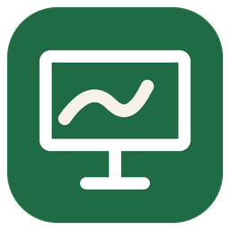

## ⬇ Qual arquivo baixar?

| Para quê | Arquivo | |
|---|---|---|
| **Instalar no computador (Windows)** | Instalar-GizNaTela-1.4.2.zip | [**Baixar**](https://github.com/HeraldoAntunes/giz-na-tela/releases/download/v1.4.2/Instalar-GizNaTela-1.4.2.zip) |
| Escola sem internet (leva o WebView2 da Microsoft junto) | GizNaTela-1.4.2-sem-internet.zip | [Baixar](https://github.com/HeraldoAntunes/giz-na-tela/releases/download/v1.4.2/GizNaTela-1.4.2-sem-internet.zip) |
| Usar sem instalar (versão portátil, para pendrive) | GizNaTela-1.4.2-portatil.zip | [Baixar](https://github.com/HeraldoAntunes/giz-na-tela/releases/download/v1.4.2/GizNaTela-1.4.2-portatil.zip) |

Quem tem a 1.4.0 ou a 1.4.1 pode atualizar pelo próprio programa: **Ajuda e ajustes → Sobre → Procurar versão nova →
Instalar**. Ou extraia o zip (botão direito, **Extrair tudo**) e dê dois cliques em **Instalar-GizNaTela-1.4.2.exe**:
ele instala por cima, e os ajustes e as imagens salvas ficam. Quem tem a 1.3.x precisa baixar o zip aqui uma vez (o
botão Instalar da 1.3.x não acha o instalador dentro do zip). Os outros arquivos da lista (SHA256SUMS e .sigstore.json)
servem só para conferir o download. Se o Windows avisar "o Windows protegeu o computador", clique em **Mais
informações → Executar assim mesmo** (o programa é gratuito e não tem assinatura paga).

---

## O que mudou

Versão de correções, com um ajuste novo, a partir do uso em aula.

- **O Espaço não abre nem fecha o Giz com um vídeo por baixo:** apertar o Espaço para pausar o vídeo escolhia a mão
  e fazia o Giz voltar a pegar o clique. O Espaço deixou de ser atalho e a mão (Mover) passou para a tecla **I**. No
  Mouse livre, o teclado agora vai para o programa de baixo, e o Espaço pausa e continua o vídeo.
- **Tinta que some com tempo ajustável:** em Ajuda e ajustes, 2, 3 (de fábrica), 5 ou 10 segundos.
- **Lista de Aplicativos instalados sem a versão antiga:** num computador com uma instalação antiga incompleta, a lista
  do Windows podia mostrar a versão velha ao lado da nova. O instalador e o programa tiram essa entrada que sobrou.
- **Sem sobras na pasta temporária** depois de atualizar ou desinstalar.
- **Reabrir logo depois de uma queda:** às vezes o programa reaberto às pressas saía sem abrir. Agora ele espera um
  pouco e abre.
- **Conexão do WebView2, com o número medido:** o componente da Microsoft que desenha a janela pode abrir sozinho uma
  conexão com a Microsoft. Na 1.4.1, um Windows de testes não teve nenhuma; o computador de uso do autor teve uma em
  cada uma das 5 aberturas de 10 minutos. A ajuda e o README agora dizem os dois números. Nada seu passa por essa
  conexão, e o firewall do Windows pode bloqueá-la.
- **Registro no INPI** (BR 51 2026 010708-3) no README e no Sobre.

**Como foi testada:** os testes automáticos (entre eles os do teclado: o Espaço não muda nada, a I escolhe a mão, e o
tempo da tinta em 2, 3, 5 e 10 s), a verificação antes de publicar (os três arquivos deram zero alertas em 74
antivírus no VirusTotal) e, num notebook com Windows 10, os testes com janela: todos os comandos, 150 reaberturas
depois de queda, camada, falhas do WebView2, e instalar, abrir, conferir a lista do Windows e desinstalar. O Espaço com
um vídeo por baixo foi testado num Windows 11, 3 de 3. Mesa digitalizadora, projetor e duas telas ficam para o uso em
aula.

**Conferir o download:** o `SHA256SUMS.txt` traz o SHA-256 de cada arquivo, uma "impressão digital" dele (no Windows, abra o Prompt de Comando na pasta do download e digite `certutil -hashfile Instalar-GizNaTela-1.4.2.zip SHA256`). Cada arquivo também tem a assinatura digital gratuita do Sigstore (o `.sigstore.json` com o mesmo nome): mostra que o arquivo saiu deste repositório pelo GitHub. Quem não vai conferir pode ignorar. Como conferir: [SECURITY.md](https://github.com/HeraldoAntunes/giz-na-tela/blob/main/.github/SECURITY.md).
